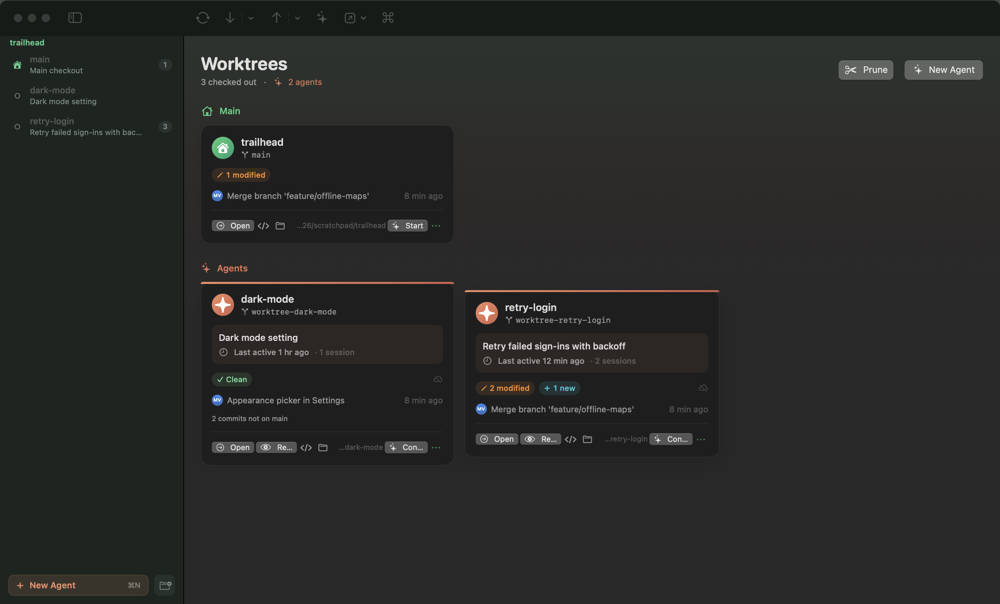
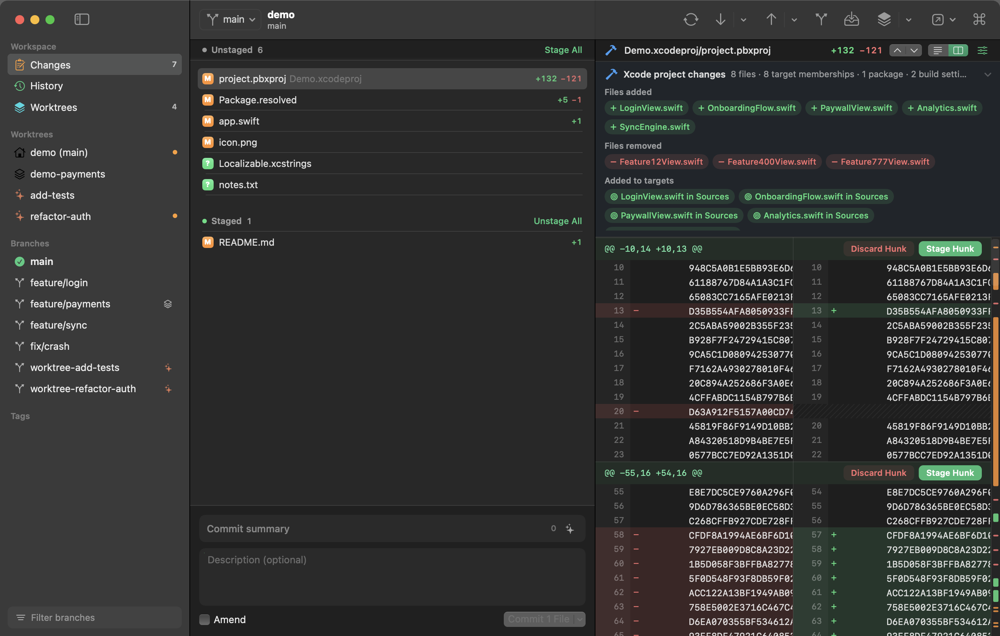
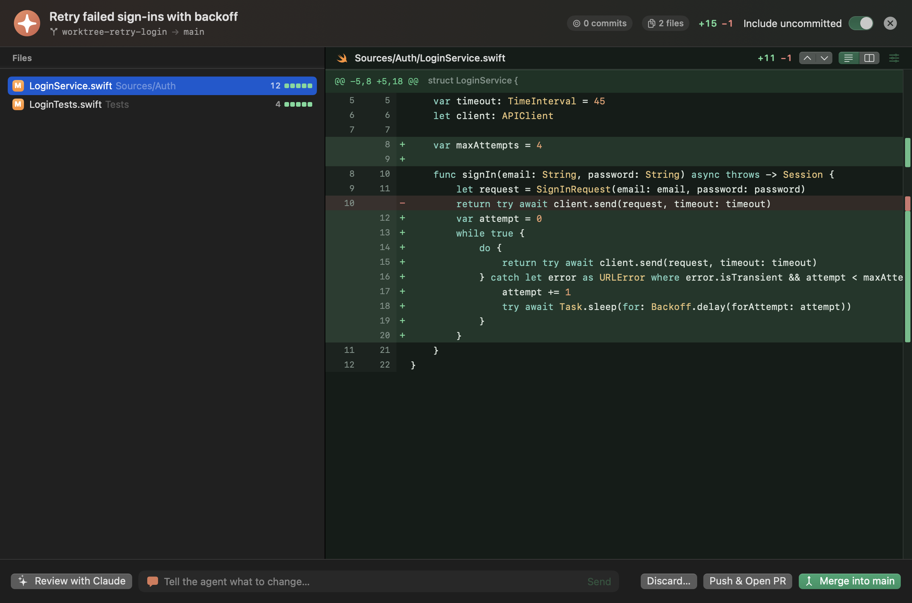
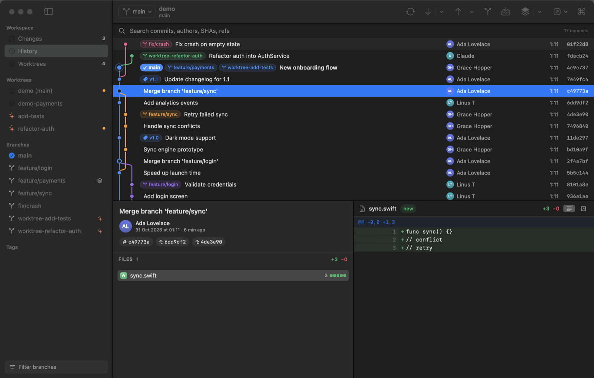
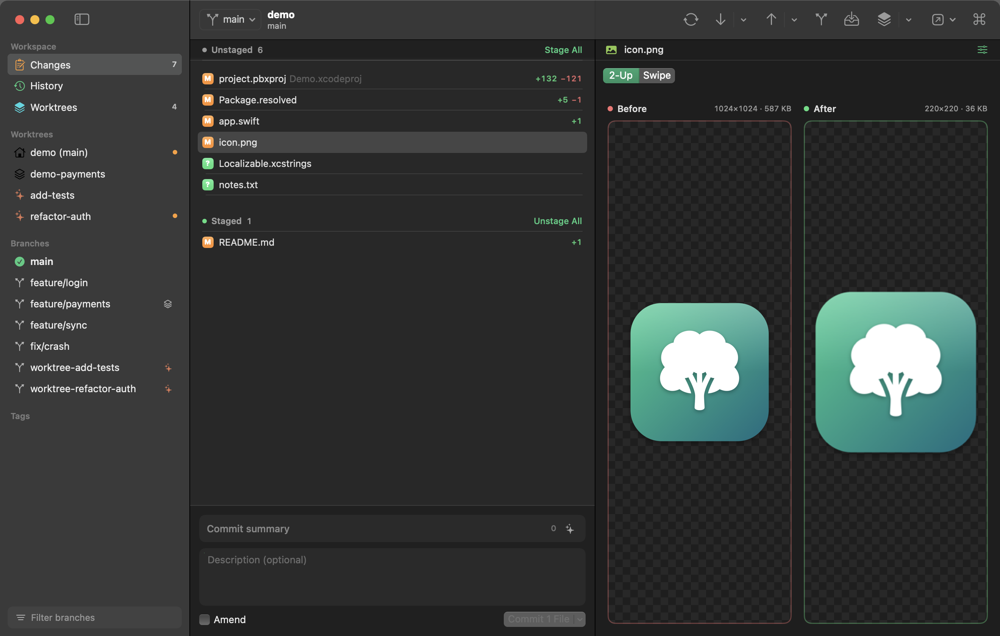

<p align="center"></p>

<h1 align="center">Forest</h1>
<p align="center"><b>A happy, native Git client for macOS, built for worktrees and Claude Code agents.</b></p>



Forest is a SwiftUI Git client that treats **worktrees** as first-class and understands the **Claude Code agents**
running in them. It's fast on huge diffs, it explains what changed in an Xcode project, and almost everything it does
can be undone.

## Features

**Worktrees & agents**
- Worktrees dashboard: main, Claude agents and native worktrees, each with dirty state, ahead/behind, last commit, commits not yet on main, and its pull request with CI status
- Agent cards read Claude Code's transcripts to show the session title, the original task, a live "working now" pulse, and any PR it opened
- **New Claude Agent** (⌥⌘N): describe a task and Forest creates `.claude/worktrees/<name>` on `worktree-<name>`, then launches Claude Code in your terminal with that task
- **Review an agent's work**: every commit and file it changed against main (uncommitted work included), a one-click Claude review, and a box to send feedback straight back into the agent's session
- Merge into main, push & open a PR, continue the session, lock, or remove the worktree and branch in one step

**Claude helpers** (use your Claude Code login, run with tools disabled)
- ✨ **Write the commit message** from the staged changes, following your repo's conventions (⌥⌘M)
- **Explain a commit**: what it does and what to watch out for, right in History
- **Resolve conflicts with Claude**: hands the conflicted files to Claude Code; you review before continuing

**Diffs that stay fast**
- A custom renderer draws only what's on screen: 100 000-line files scroll smoothly
- Unified or side-by-side, word-level highlights, syntax colours, wrap, whole-file view, hide whitespace
- Overview ruler and next/previous change (⌥⌘↓ / ⌥⌘↑)
- **Xcode projects in plain words**: `project.pbxproj` changes are summarised as files added and removed, target membership, packages and build settings (old → new)
- Lockfiles (`Package.resolved`, `package-lock.json`, `yarn.lock`, …) collapse by default
- Images compare side by side or with a swipe slider
- Stage, unstage or discard hunks or **individual lines**: click, drag or ⇧-click lines, then use the hunk buttons or right-click

**Everything Git**
- Commit graph with colored lanes, ref badges, search, keyboard navigation, and "show only this branch"
- Commit, amend, and commit & push, with a little celebration
- **Undo** (⌥⌘Z, or the toast's Undo button) for commits, discards, checkouts, branch deletes, merges, rebases, cherry-picks, reverts, pulls, resets and stashes
- Drag a branch onto the current one to merge it, or the current branch onto another to rebase
- Branches, remotes, tags and stashes; merge, rebase, cherry-pick, revert and reset
- Conflict banner with ours/theirs/mark resolved, plus continue/abort
- Fetch, pull (ff-only, merge or rebase), push with automatic upstream or force-with-lease
- ⌘K command palette, live refresh through FSEvents, clone/init/open, drag-and-drop folders
- Themes for diffs: Solarized Dark (default), Solarized Light, Dracula, One Dark, Monokai, Nord, Gruvbox, Tokyo Night, Catppuccin, GitHub Dark and Light
- Updates itself from GitHub Releases, installing only builds signed by the same developer and notarized by Apple

| Xcode project, side by side | Reviewing an agent |
|---|---|
|  |  |

| History | Image diff |
|---|---|
|  |  |

## Build & run

Requires macOS 14+ and Xcode 16+ (Swift 6 toolchain).

```sh
scripts/build-app.sh          # builds build/Forest.app (release)
open build/Forest.app
open build/Forest.app --args ~/code/my-repo   # open a repo directly
```

To ship a signed, notarized build (`build/Forest-<version>.dmg` and `.zip`), you need a Developer ID Application
certificate and a `notary` keychain profile (`xcrun notarytool store-credentials notary …`). Then run:

```sh
scripts/release.sh
```

The version comes from the latest `v*` tag (default 0.2.0); the build number is the commit count.

For development, `swift run Forest`, or open `Package.swift` in Xcode. Run tests with `swift test`.

Optional: install the [GitHub CLI](https://cli.github.com) (`gh auth login`) to see pull requests and CI status.

## Architecture

```
Sources/ForestCore   Git engine: runs the system git binary, parses porcelain output, lays out the commit
                     graph and diffs, builds partial-staging patches, summarises Xcode projects,
                     reads Claude sessions, runs headless Claude and gh
Sources/Forest       SwiftUI app: RepoStore (per-window state & actions), views, and the AppKit diff canvas
Tests/               Swift Testing suites, many against real temporary repositories
```

Forest shells out to your own `git`, so hooks, credential helpers, LFS, signing and config work exactly as they do on
the command line.

## Keyboard shortcuts

| | |
|---|---|
| ⌘1 / ⌘2 / ⌘3 | Changes / History / Worktrees |
| ⌘K | Command palette |
| ⌘↩ | Commit |
| ⌥⌘M | Write commit message with Claude |
| ⌥⌘Z | Undo last action |
| ⌥⌘↓ / ⌥⌘↑ | Next / previous change in a diff |
| ⇧⌘F / ⇧⌘P / ⇧⌘U | Fetch / Pull / Push |
| ⇧⌘B | New branch |
| ⇧⌘T | New worktree |
| ⌥⌘N | New Claude agent |
| ⌥⌘L | Launch Claude Code here |
| ⌥⌘S | Stash |
| Space / double-click | Stage or unstage selected files |
| Esc | Clear the line selection in a diff |

See [docs/ROADMAP.md](docs/ROADMAP.md) for what's next.
