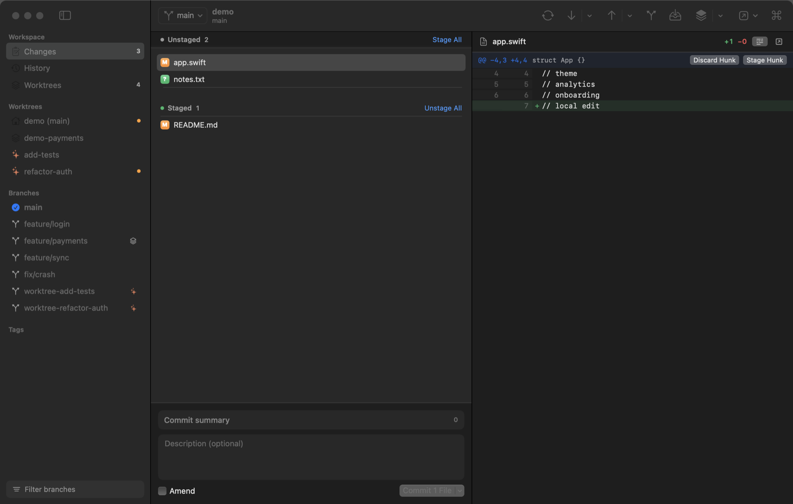

<p align="center"></p>

<h1 align="center">Forest</h1>
<p align="center"><b>A beautiful, native Git client for macOS, built for worktrees and Claude Code agents.</b></p>


Forest is a SwiftUI Git client in the spirit of Fork and Tower. It treats **worktrees** as first-class, and is the
first client that understands **Claude Code agents** running in them. See
[docs/COMPETITIVE_ANALYSIS.md](docs/COMPETITIVE_ANALYSIS.md) for how it compares to Fork, Tower, Sourcetree,
GitKraken and Sublime Merge.

## Features

**Worktrees & agents**
- Worktrees dashboard: main, Claude agents and native worktrees, each with dirty state, ahead/behind, last commit and commits not yet on main
- Claude agent cards read Claude Code's transcripts to show the session title, the original task, a live "working now" indicator, and any PR it opened
- **New Claude Agent** (⌥⌘N): describe a task and Forest creates `.claude/worktrees/<name>` on `worktree-<name>` (the same layout as `claude --worktree`), then launches Claude Code in your terminal with that task
- Merge an agent's work into main, push & open a PR, lock it, or remove the worktree and branch in one step
- Native worktrees: new branch, existing branch, or detached; sibling or nested location; open each in its own window

**Everything Git**
- Commit graph with colored lanes, ref badges, search, and keyboard navigation
- Stage, unstage or discard whole files, hunks, or **individual lines** (click or ⇧-click line numbers)
- Intra-line diff highlighting, wrap toggle, open in your editor
- Commit, amend, and commit & push
- Branches, remotes, tags (lightweight & annotated) and stashes
- Merge, rebase, cherry-pick, revert, and soft/mixed/hard reset
- Conflict banner with ours/theirs/mark resolved, plus continue/abort
- Fetch, pull (ff-only, merge, or rebase), and push with automatic upstream or force-with-lease
- ⌘K command palette, live refresh through FSEvents, clone/init/open, and drag-and-drop folders

| History | Changes |
|---|---|
|  |  |

## Build & run

Requires macOS 14+ and Xcode 16+ (Swift 6 toolchain).

```sh
scripts/build-app.sh          # builds build/Forest.app (release)
open build/Forest.app
open build/Forest.app --args ~/code/my-repo   # open a repo directly
```

For development, `swift run Forest`, or open `Package.swift` in Xcode. Run tests with `swift test`.

## Architecture

```
Sources/ForestCore   Git engine: runs the system git binary, parses porcelain output,
                     lays out the commit graph, builds partial-staging patches, reads Claude sessions
Sources/Forest       SwiftUI app: RepoStore (per-window state & actions) and views
Tests/               Swift Testing suites against real temporary repositories
```

Forest shells out to your own `git`, so hooks, credential helpers, LFS, signing and config work exactly as they do on
the command line.

## Keyboard shortcuts

| | |
|---|---|
| ⌘1 / ⌘2 / ⌘3 | Changes / History / Worktrees |
| ⌘K | Command palette |
| ⌘↩ | Commit |
| ⇧⌘F / ⇧⌘P / ⇧⌘U | Fetch / Pull / Push |
| ⇧⌘B | New branch |
| ⇧⌘T | New worktree |
| ⌥⌘N | New Claude agent |
| ⌥⌘L | Launch Claude Code here |
| ⌥⌘S | Stash |
| Space / double-click | Stage or unstage selected files |
