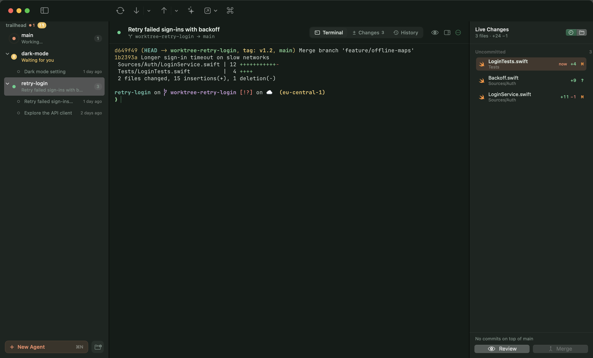
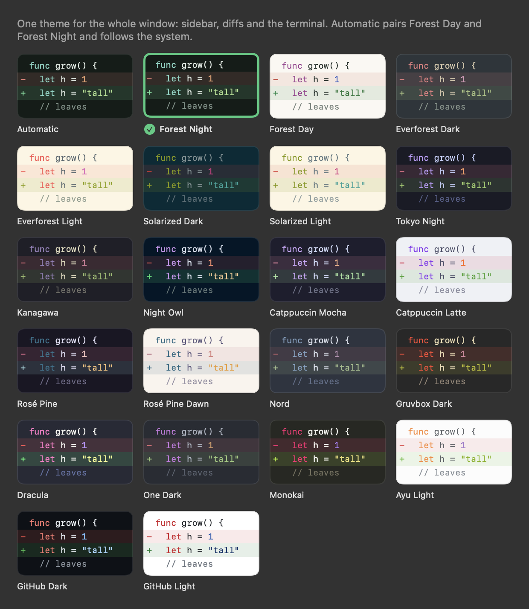
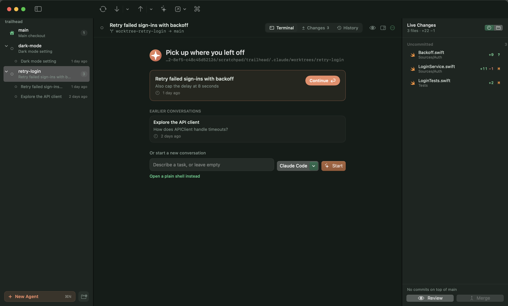
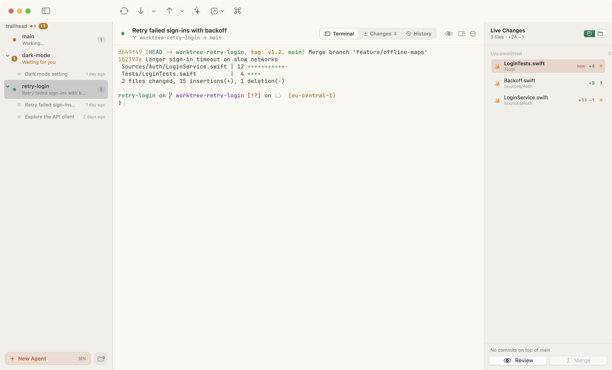
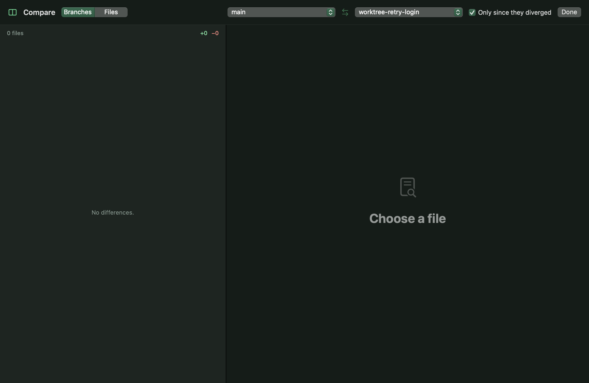
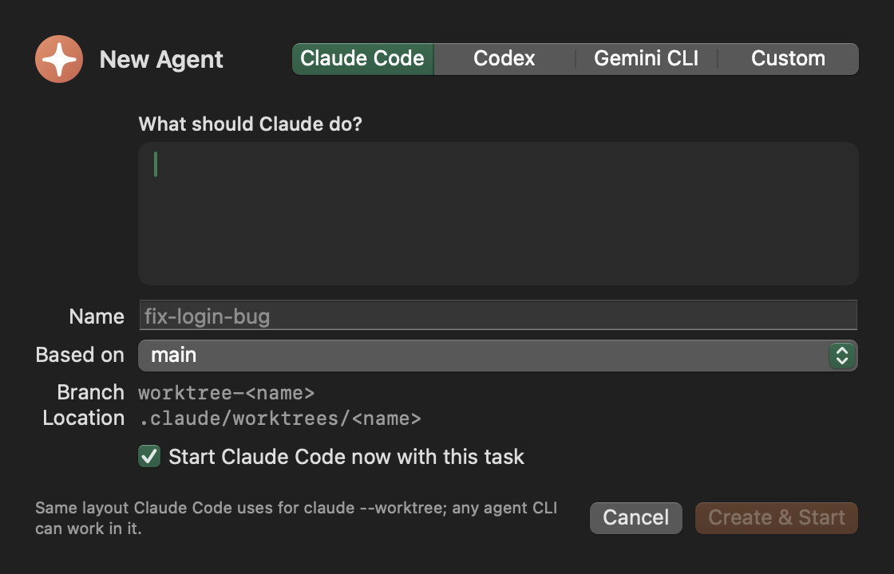
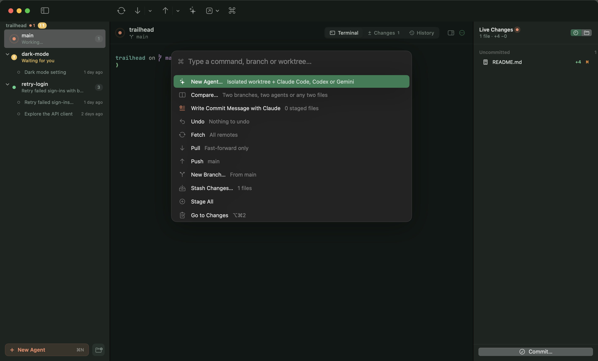

<p align="center"></p>

<h1 align="center">Forest</h1>

<p align="center"><b>One window for your coding agents: their terminals, their changes, and a native Git client.</b></p>

<p align="center">
  <a href="https://github.com/pballada/forest/releases/latest"></a>
  <a href="https://github.com/pballada/forest/releases"></a>
  
  
  
  
</p>
<p align="center">
  
  
  
  <a href="https://ghostty.org"></a>
  <a href="https://github.com/pballada/forest/commits/main"></a>
</p>

<p align="center">
  <a href="https://github.com/pballada/forest/releases/latest"><b>Download for macOS</b></a> ·
  <a href="#quick-start">Quick start</a> ·
  <a href="#features">Features</a> ·
  <a href="#keyboard-shortcuts">Shortcuts</a> ·
  <a href="#help">Help</a> ·
  <a href="#build-from-source">Build</a>
</p>



Running several coding agents usually means a terminal tab per worktree, a Git app somewhere else and a diff tool on
top. Forest puts them in one place:

- **Left**: an accordion of projects → agents' worktrees → their sessions, each showing what the agent is doing right now.
- **Middle**: that worktree's **terminal** (real Ghostty), its **changes**, or its **history**.
- **Right**: files appearing **live** as the agent writes them, with Review and Merge one click away.

Claude Code is the first-class citizen; Codex, Gemini CLI or any command run just as well.

## Install

1. [Download the latest `Forest-<version>.dmg`](https://github.com/pballada/forest/releases/latest) and drag Forest to
   Applications. Builds are signed and notarized by Apple, and Forest updates itself from GitHub Releases.
2. Have at least one agent CLI on your machine: [Claude Code](https://docs.claude.com/en/docs/claude-code),
   [Codex](https://github.com/openai/codex) or [Gemini CLI](https://github.com/google-gemini/gemini-cli).
3. Optional: the [GitHub CLI](https://cli.github.com) (`gh auth login`) for pull requests and CI status.

Requires macOS 14 or later on Apple silicon. Forest uses your own `git`, so hooks, credential helpers, LFS, signing
and config behave exactly as on the command line.

## Quick start

1. **Add a project** (⌘O), or drop a repository folder on Forest's Dock icon.
2. **New Agent** (⌘N): describe the task, pick Claude Code, Codex or Gemini, and Forest creates
   `.claude/worktrees/<name>` on its own branch and starts the agent there.
3. Watch it work in the terminal while files light up in **Live Changes**. A **!** on its row (and the Dock badge)
   means it's waiting for you.
4. **Review** (⇧⌘R) what it changed against main, send feedback straight into its session, then **Merge** or push a PR.
5. Quit whenever you like: next time, the agent's card offers **Continue** (↩) to resume that exact conversation.

## Features

### Agents and sessions
- **One window, every project**: a sidebar accordion of projects, their worktrees and each worktree's sessions. Fold
  a project and its header still sums up how many agents are working and how many are waiting for you.
  ⌘1…⌘9 and ⌃Tab jump between worktrees like tabs; click a session to resume it.
- **Know what each agent is doing at a glance**:

  | Indicator | Meaning |
  |---|---|
  | Pulsing dot | The agent is working |
  | Orange **!** | It's waiting for your input (a permission, a question, the bell) |
  | Solid dot | A session is open and the agent is idle |
  | Hollow ring | Nothing running; **Continue** resumes it |

- **Hear it when an agent needs you**: pick a sound for "needs your input" and another for "finished" (any macOS
  sound, or none), play them only when Forest is in the background, and optionally get a notification. The Dock
  badge counts agents waiting for you.
- **Continue sessions easily**: a worktree without a running terminal lists its Claude conversations by title, so you
  can resume the last one (`claude --resume <id>`), pick an earlier one, or start fresh with a task. Codex and Gemini
  continue with `codex resume --last` and `gemini --resume latest`.
- **Any agent**: Claude Code, Codex, Gemini CLI or a custom command, chosen per agent or by default in
  Settings › Agents.
- Merge into main, push and open a PR, lock, or remove the worktree and branch in one step.

### A real terminal, embedded
- Every worktree gets a [Ghostty](https://ghostty.org) terminal (libghostty, GPU-rendered) that reads your Ghostty
  config for fonts and keybindings and wears Forest's theme. ⌘D adds a shell underneath.
- Terminals keep running while you switch between worktrees: no lost scrollback.

### Live changes, review and compare
- **Live Changes**: files appear the moment they're written, freshest first and briefly lit, with line counts and what
  the branch has already committed on top of main.
- **Review an agent**: every commit and file it changed against main (uncommitted work included), a one-click Claude
  review, and feedback typed straight into its running session.
- **Compare** (⌥⌘C) two branches, two agents' worktrees (fully, or only since they diverged), or any two files on disk.

### A complete Git client
- Commit graph with coloured lanes, ref badges, search and "show only this branch"; branches, remotes, tags and
  stashes beside it.
- Commit, amend, commit & push; stage, unstage or discard hunks or **individual lines**.
- **Undo** (⌥⌘Z) for commits, discards, checkouts, branch deletes, merges, rebases, cherry-picks, reverts, pulls, resets
  and stashes.
- Drag a branch onto the current one to merge, or the current one onto another to rebase. Conflict banner with
  ours/theirs, continue and abort.
- Claude helpers that use your Claude Code login: **write the commit message** (⌥⌘M), **explain a commit**, **resolve
  conflicts**.

### Diffs that stay fast
- A custom renderer draws only what's on screen: 100 000-line files scroll smoothly.
- Unified or side by side, word-level highlights, syntax colours, wrap, whole-file view, hide whitespace.
- `project.pbxproj` changes in plain words (files, targets, packages, build settings); lockfiles collapsed; images side
  by side or with a swipe slider.

### Themes
22 themes for the whole window, diffs and terminal: **Forest Night** and **Forest Day** (Automatic follows the system),
Everforest Dark and Light, Solarized Dark and Light, Tokyo Night, Kanagawa, Night Owl, Catppuccin Mocha and Latte,
Rosé Pine and Rosé Pine Dawn, Nord, Gruvbox, Dracula, One Dark, Monokai, Ayu Light, GitHub Dark and Light. Each comes
with a tuned terminal palette, and selections stay readable in all of them.

### Always up to date
Forest checks GitHub Releases at launch and every few hours, downloads a new version in the background, verifies its
Developer ID signature and notarization, and installs it when you quit. A "ready" note in the sidebar lets you restart
into it right away; Forest never restarts on its own, so running agents aren't interrupted. Forest › Check for
Updates… checks on demand.

<p align="center"></p>

## Gallery

| Continue where you left off | All agents of a project |
|---|---|
|  |  |

| History, with branches beside the graph | Forest Day |
|---|---|
|  |  |

| Reviewing an agent | Compare |
|---|---|
|  |  |

| New agent | Command palette |
|---|---|
|  |  |

## Keyboard shortcuts

<details>
<summary>Show all shortcuts</summary>

| Shortcut | Action |
|---|---|
| ⌘N | New agent |
| ⌘O | Add project |
| ⌘1 … ⌘9 · ⌃Tab / ⌃⇧Tab | Go to worktree n · next / previous |
| ⌥⌘1 / ⌥⌘2 / ⌥⌘3 | Terminal / Changes / History |
| ⇧⌘↩ | Continue the last session |
| ⌘D | Shell under the terminal |
| ⌥⌘0 | Show or hide Live Changes |
| ⇧⌘R | Review agent |
| ⌥⌘C | Compare |
| ⌘K | Command palette |
| ⌘↩ | Commit |
| ⌥⌘M | Write commit message with Claude |
| ⌥⌘Z | Undo last action |
| ⌥⌘↓ / ⌥⌘↑ | Next / previous change in a diff |
| ⇧⌘F / ⇧⌘P / ⇧⌘U | Fetch / Pull / Push |
| ⇧⌘B | New branch |
| ⌥⌘S | Stash |
| Space / double-click | Stage or unstage selected files |
| Esc | Clear the line selection in a diff |

Inside a terminal every other key goes to the program, and your Ghostty keybindings (copy, paste, font size…) work as
usual.
</details>

## Help

### Concepts
- **Project**: a Git repository you added. Its **main checkout** is the folder you opened.
- **Agent**: a worktree in `.claude/worktrees/<name>` on branch `worktree-<name>`, where one agent works without
  touching your checkout. It's the same layout `claude --worktree` uses, so agents you start from the command line
  show up in Forest too.
- **Session**: a conversation with the agent. Claude Code records each one in `~/.claude/projects`; Forest reads them
  (read-only) to show titles and to resume them.
- **Row states**: a pulsing dot means *working*, an orange **!** means *waiting for you* (a permission prompt, a
  question, the bell), a solid dot means *session open, agent idle*, and a hollow ring means *not running*
  (Continue brings it back).

### FAQ

<details>
<summary><b>Do I need Ghostty installed?</b></summary>

No. The terminal engine is built into Forest. If you do use Ghostty, Forest reads your `~/.config/ghostty/config`
for fonts and keybindings; colours follow Forest's theme unless you turn on *Use my Ghostty colours* in
Settings › Terminal.
</details>

<details>
<summary><b>What happens to running agents when I quit Forest?</b></summary>

Their terminals close with Forest, but nothing is lost: the conversation is saved by the agent itself. Select the
worktree and press ↩ on **Continue** to pick up exactly where it stopped (`claude --resume <id>`, `codex resume
--last` or `gemini --resume latest`).
</details>

<details>
<summary><b>Can I use my own git worktrees (outside <code>.claude/worktrees</code>)?</b></summary>

Forest focuses on agent worktrees and the main checkout, so other linked worktrees aren't listed. Branches checked out
in them still say so, and git commands keep working as usual.
</details>

<details>
<summary><b>Which keys does Forest keep for itself inside the terminal?</b></summary>

⌘N, ⌘O, ⌘K, ⌘D, ⌘1…⌘9, ⌃Tab and the ⌥⌘ shortcuts above. Everything else, including your own Ghostty keybindings,
goes to the terminal.
</details>

<details>
<summary><b>How do I get a sound when an agent needs me?</b></summary>

Settings › Agents: choose a sound for "When an agent needs you" (Glass by default) and, if you like, one for "When an
agent finishes". You can limit sounds to when Forest is in the background and turn on macOS notifications.
</details>

<details>
<summary><b>How do updates work?</b></summary>

Automatically: new versions download in the background and install when you quit Forest, or right away with Restart.
Turn it off in Settings › General; Forest › Check for Updates… still works.
</details>

<details>
<summary><b>Is anything sent anywhere?</b></summary>

Only what you ask for: the Claude helpers (commit message, explain, review) send the relevant diff to Claude through
your own Claude Code login, and update checks read the GitHub Releases API. Agents themselves run with your CLI and
your account.
</details>

### Troubleshooting

| Problem | Try this |
|---|---|
| "claude: command not found" in the terminal | Install the CLI, or set its path in Settings › Agents. The terminal runs your login shell, so it uses your usual `PATH`. |
| No sound when an agent needs me | Check Settings › Agents (sound not "None", "only in background" off while testing) and the system volume. The agent has to ring the bell or post a terminal notification; Claude Code does both. |
| An agent's row never shows *working* | Claude Code reports progress to the terminal; if it doesn't, Forest falls back to the transcript, which can take a few seconds. Make sure the session runs inside Forest's terminal. |
| No titles in the sidebar | Titles come from Claude Code transcripts in `~/.claude/projects`. Codex and Gemini sessions show "No conversation yet" but still continue with ↩. |
| Removing an agent fails | Quit the agent first (it may hold a lock), then Remove again; Forest force-removes locked worktrees. |
| Pull requests or CI aren't shown | Install the GitHub CLI and run `gh auth login`, then Refresh (⌘R). |
| Keys don't reach the program | Click inside the terminal to focus it. If a Forest shortcut clashes with a tool you use, tell us in an issue. |

Still stuck? [Open an issue](https://github.com/pballada/forest/issues/new) with your macOS version, Forest version
(Forest › About Forest) and what you did. Help › Forest Help in the app brings you back here.

## Build from source

<details>
<summary>Requirements, build and release</summary>

Requires macOS 14+, Xcode 16+ (Swift 6 toolchain) and [Zig](https://ziglang.org) for libghostty (`brew install zig`,
the version Ghostty's `build.zig.zon` asks for).

```sh
scripts/build-ghosttykit.sh   # once: builds libghostty from Ghostty's official source into Vendor/
scripts/build-app.sh          # builds build/Forest.app (release; runs the step above if needed)
open build/Forest.app --args ~/code/my-repo
```

For development use `swift run Forest` (after `scripts/build-ghosttykit.sh`) or open `Package.swift` in Xcode, and run
the tests with `swift test`.

A signed, notarized release (`build/Forest-<version>.dmg` and `.zip`) needs a Developer ID Application certificate and
a `notary` keychain profile (`xcrun notarytool store-credentials notary …`):

```sh
scripts/release.sh   # version from the latest v* tag; build number = commit count
```

`FOREST_SNAPSHOT_DIR=<dir>` makes a build walk through its main screens and write PNGs (see
`Sources/Forest/Support/Snapshotter.swift`); that's how the screenshots above are made.
</details>

<details>
<summary>Architecture</summary>

```
Sources/ForestCore      Git engine: runs the system git binary, parses porcelain output, lays out the commit
                        graph and diffs, builds partial-staging patches, summarises Xcode projects, indexes
                        Claude Code sessions (incrementally), runs headless Claude and gh
Sources/ForestTerminal  The only code that talks to libghostty: the shared app and config, the surface view
                        (keyboard with IME, mouse, clipboard) and TerminalSession, which outlives its views
Sources/Forest          SwiftUI app: WorkspaceStore (projects, selection) → ProjectStore (worktrees, terminals,
                        agent state) → RepoStore (one per worktree: status, history, actions), views, diff canvas
Vendor/                 GhosttyKit.xcframework and Ghostty's shell integration + terminfo (built, not committed)
Tests/                  Swift Testing suites, many against real temporary repositories
```
</details>

## Roadmap and feedback

See [docs/ROADMAP.md](docs/ROADMAP.md) for what's next. Bugs and ideas are welcome in
[Issues](https://github.com/pballada/forest/issues).

## Credits

The embedded terminal is [Ghostty](https://ghostty.org)'s libghostty (MIT licensed); its licence ships inside the app.
Claude Code is a product of Anthropic, Codex of OpenAI and Gemini CLI of Google; Forest isn't affiliated with any of
them.
